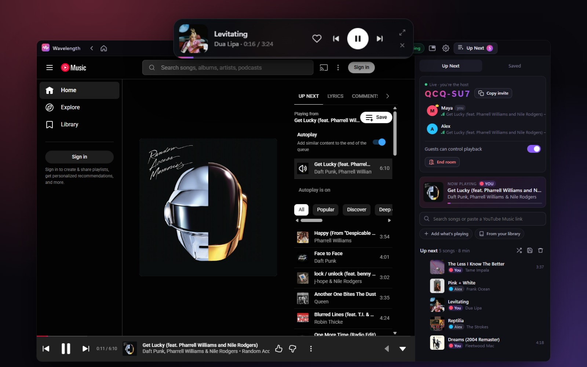

# Wavelength

A desktop player for **YouTube Music** with a floating mini player, global hotkeys,
a built-in ad blocker, and **listen-together rooms**: share a code, and everyone hears
the same songs at the same moment, with a shared Up Next anyone can add to.

**[Website](https://orionvw42.github.io/wavelength/) · [Download for Windows](https://github.com/OrionVW42/wavelength/releases/latest)**



## Install

Download `Wavelength-Setup-<version>.exe` from the
[latest release](https://github.com/OrionVW42/wavelength/releases/latest) and run it.
It installs for your Windows user only (no admin prompt) and opens when done.

> Windows may show **"Windows protected your PC"** because the installer isn't
> code-signed. Click **More info → Run anyway**.

## First run

1. Click **Sign in** (top right of YouTube Music) and sign in with your Google account.
   Your library, playlists and liked songs are now there, same as on the website.
2. Play anything. The mini player drops in at the top of your screen.

## Everyday use

| | |
|---|---|
| **Mini player** | Floats over every window and pops out when you minimize or close the full player. Move it by the handle on top, resize it from the corner. Scroll for volume, click the bar to seek, 🔍 to search and add a song. |
| **Up Next** (right panel) | Your queue. It plays before YouTube Music's own autoplay. Search from the title bar, **right-click any song, album or playlist** to add it (with Undo), or use YouTube Music's ⋮ → *Play next*. Drag to reorder. |
| **Data saver** | On by default: album art instead of music videos, stream held at 144p. The ▶ Show video button (or Ctrl+Alt+V) brings video back. |
| **Updates** | Wavelength updates itself in the background (a few MB) and asks you to restart. |
| **From your library** | Add a whole playlist (or Liked Music) to Up Next, in order or shuffled. |
| **Save** | The 💾 button saves what's playing plus Up Next (and optionally what already played) as a playlist. Find it under **Saved**: play it again, rename it, or push it into your YouTube Music library. |
| **Closing** | Closing the window keeps the music going in the system tray. Quit from the tray icon. |

### Default hotkeys (change them in Settings)

| Action | Keys |
|---|---|
| Play / pause | `Ctrl+Alt+Space` (and your keyboard's ⏯ key) |
| Next / previous | `Ctrl+Alt+→` / `Ctrl+Alt+←` (and ⏭ / ⏮) |
| Volume up / down | `Ctrl+Alt+↑` / `Ctrl+Alt+↓` |
| Like song | `Ctrl+Alt+L` |
| Show / hide full player | `Ctrl+Alt+M` |
| Show / hide mini player | `Ctrl+Alt+N` |
| Search from the mini player | `Ctrl+Alt+S` |
| Video on / off | `Ctrl+Alt+V` |

## Listen together

1. One person opens **Up Next → Start a room** and clicks **Copy invite**.
2. Friends paste the code (like `K7Q-M2X`) into **Join**.
3. Everyone's player follows the host: same song, same spot, pause and skip
   together. Anyone can add songs; each one shows who added it. The room list shows
   what every member is listening to, live.
4. Turn off **Listen in sync** to go solo while staying in the room. You'll still
   see the queue and can keep adding songs.
5. The host can lock playback controls so guests can only add songs.

Everyone needs their own copy of Wavelength. Friends don't need YouTube Music
Premium or even an account: playback works signed out too.

Rooms connect your computers directly (peer-to-peer). When your networks can't
connect directly (strict routers, phone hotspots, Starlink, school or work
networks), Wavelength switches to an encrypted relay within a few seconds: room
messages go through free public MQTT servers, encrypted with a key made from the
room code. Everyone in a room needs version 1.2 or newer for the relay. If
joining still fails, set **Settings → Room connection → Always relay** on both PCs.

## Discord bot

Wavelength has a Discord bot built in. Turn it on in **Settings → Discord bot**, paste
your bot's token (Discord Developer Portal → your app → Bot → Reset Token), and add the
bot to your server with the **Add to server** button.

- In a voice channel, type `/join`. The bot plays **whatever Wavelength is playing**
  (your own music, a room you're hosting, or a room you joined), straight from the
  player, so Discord hears the same ad-free stream at the same moment.
- `/play` adds songs to Up Next, credited to whoever asked. `/search` lets you pick
  from results. `/np` posts a live now-playing card with ⏮ ⏯ ⏭ buttons.
  `/queue`, `/skip`, `/previous`, `/pause`, `/resume`, `/volume`.
- `/room start` hosts a listening room, `/room join code:K7Q-M2X` joins one, and
  `/room info` shows the code so friends can join from the Wavelength app.
- The bot runs inside Wavelength, so it's online while Wavelength is open.

## Notes

- The ad blocker removes YouTube's audio/video ads and promo banners. YouTube
  changes things often; if an ad slips through, it's muted and fast-forwarded.
- If Google ever says the browser "may not be secure" while signing in, toggle
  **Settings → Google sign-in compatibility** and try again.

## For developers

```bash
npm install
npm start                 # run from source
node tests/together.js    # two-instance listen-together test (real network)
npm run dist              # build the installer + the auto-update files in dist/
node tests/updater.js     # end-to-end auto-update test on the packaged app
```

The smoke test runs the real app against YouTube Music, muted:
`WL_TEST_SCRIPT=tests/smoke.js WL_USERDATA=<temp dir> npx electron .`
